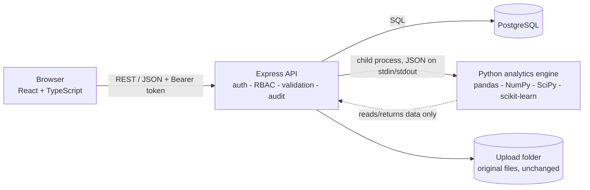

# Architecture

## Components and data flow

The Python engine never talks to the database: the API passes it data and stores what it returns. This keeps one
place for security, authorisation and persistence, and avoids a second long-running service on Windows.
Calls: `inspect` (columns, types, suggested mapping), `process`, `trends`, `compare`, `regions`, `forecast`, `anomalies`.

## Pipeline

1. **Upload** – extension + content sniffing + size check; file stored under a random name; SHA-256 recorded; row in
   `datasets` and `dataset_files` (upload history). Duplicate files are rejected.
2. **Inspect/validate** – columns, types, missing cells, duplicate rows, suggested mapping → `validation_report`.
3. **Mapping** – user confirms which column is period / value(s) / indicator / category / area / unit (wide or long layouts).
4. **Process** – dates normalised, numbers validated, duplicates removed, units standardised, % change and moving average
   computed → `observations` (each with `dataset_id` and `source_row`) + `processing_jobs` summary.
5. **Analyse** – trends, forecasts, anomalies read from `effective_observations` (processed datasets only; archived
   datasets are excluded; newer processed data takes precedence for the same indicator/period/area).
6. **Present** – dashboards (role-specific endpoints), alerts workflow, PDF/CSV reports.

## Database (see `database/schema.sql`)

`roles, permissions, role_permissions, users, sessions` · `data_sources, datasets, dataset_files, processing_jobs` ·
`indicators, observations` · `trend_analyses, forecasts, anomaly_results, alerts` · `reports, audit_logs`.
Foreign keys with sensible cascade rules, CHECK constraints on enumerations, a unique index preventing duplicate
active uploads, a unique key on `(dataset, indicator, period, area)` preventing duplicate observations, and indexes on
the main query paths. Views `effective_observations` and `national_series` provide the analysis layer.

## Security design

* Passwords: bcrypt (cost 12); minimum length + letter + digit policy.
* Tokens: JWT (HS256) with a `jti`; every request also checks a `sessions` row, so logout, deactivation and password
  change revoke access immediately. Login errors do not reveal whether the email exists; login is rate-limited.
* Authorisation: every route declares required permissions (`requirePermission`), loaded from the database on each
  request. Frontend hiding is only cosmetic. Dashboards are role-bound.
* Uploads: allow-list of extensions, magic-byte/content checks, size limit, random stored names, no path from user input.
* Queries are parameterised; helmet security headers; CORS restricted to configured origins.
* Audit trail for sign-ins, uploads, processing, analyses, alert reviews, exports, user changes and demo resets.

## Roles → permissions

| Role | Highlights |
|---|---|
| Administrator | everything, incl. users, system/demo reset, audit logs, delete datasets |
| Data Analyst | upload, process, run analytics/AI, review alerts, generate reports |
| Regulator | dashboards, indicators, alerts (review), reports |
| Management / Policymaker | dashboards, indicators, trends, stored forecasts, reports |
